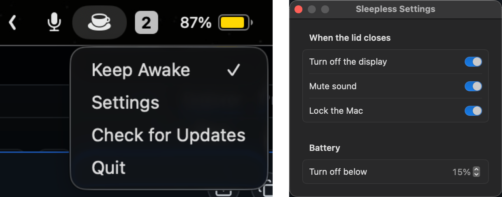

<a name="TOC"></a>

<div align="center">
  <div>Sleepless</div>
  <br />
  <a href="#-overview">Overview</a> • <a href="#-motivation">Motivation</a> • <a href="#-features">Features</a> • <a href="#-quick-start">Quick Start</a> • <a href="#-guides">Guides</a> • <a href="#-development">Development</a> • <a href="#-license">License</a>
</div>

<div width="100%" align="center">
  
</div>

## 🎺 Overview

Sleepless is a free macOS menu bar app that keeps a MacBook awake with the lid closed. That is all it does: what you run on the Mac while it stays awake is up to you.

<div align="center">
  
</div>

## ❓ Motivation

macOS sleeps the moment you close the lid, even with `caffeinate` running, and the apps that fix it are paid. I wanted to close the lid and keep my AI coding agents working while I follow them from my phone.

Other ways to use it:

- Let a long build, download or script finish with the lid closed.
- Keep your work running while you move to another place, and pick it up there.
- Use the MacBook like a Mac mini: everything runs with the lid open or closed.

## ⭐ Features

- One click to keep the Mac awake with the lid closed, on battery or plugged in, no external display needed.
- When the lid closes: turns off the display, mutes the sound and locks the Mac; each one can be switched off.
- Safety first: turns itself off below a battery level (15% by default), at critical heat, and when you quit it.
- Remembers your choice across restarts and starts at login.
- Updates from the menu with Check for Updates.
- Small and open: under 700 lines of Swift, no telemetry, network only when you check for updates.

## 🚀 Quick Start

### Install

Needs macOS 14 or later, on Apple Silicon or Intel.

```sh
curl -fsSL https://raw.githubusercontent.com/lucasvtiradentes/sleepless/main/scripts/install.sh | bash
```

Then click the moon in the menu bar and choose Keep Awake. macOS asks for your password once, and the icon turns into a cup. Close the lid: the Mac keeps running.

### Update

Choose Check for Updates in the menu, or run the install command again. Both keep the Mac awake while Sleepless restarts.

### Uninstall

Removes the app, its login item and the password rule, so the Mac sleeps with the lid closed again.

```sh
curl -fsSL https://raw.githubusercontent.com/lucasvtiradentes/sleepless/main/scripts/uninstall.sh | bash
```

## 📖 Guides

<div align="center">

<details>
<summary>How it works</summary>
<br />

<div align="left">

- macOS ignores `caffeinate` on lid close; only the system `SleepDisabled` flag stops it, set with `pmset -a disablesleep 1`.
- That needs root, so the first time you turn it on, Sleepless installs `/etc/sudoers.d/sleepless`, which allows only `pmset -a disablesleep 0` and `1` without a password.
- The icon always reads the real flag, so it stays right if something else changes it.
- It runs as a login agent from `~/Library/Application Support/sleepless`, and logs every lid change to `~/Library/Logs/dev.lucasvtiradentes.sleepless.out.log`.
- Quit other lid sleep tools, such as Amphetamine or Clamshell, so they do not reset the flag.

</div>

</details>

</div>

<div align="center">

<details>
<summary>Why a curl installer and not a download</summary>
<br />

<div align="left">

Sleepless is not signed with a paid Apple Developer ID. A file downloaded in a browser gets a quarantine flag, and macOS blocks unsigned apps that have it. The installer downloads the release with `curl`, checks its SHA-256 and signs it locally, so macOS runs it without warnings. You can also build it yourself with `make install`.

</div>

</details>

</div>

<div align="center">

<details>
<summary>Related: control the Mac from your phone</summary>
<br />

<div align="left">

Not part of Sleepless, but a common pairing: with the Mac awake, you can reach its screen from a phone with macOS Screen Sharing, Tailscale and a VNC app, all free. My setup is in [docs/remote-screen.md](docs/remote-screen.md).

</div>

</details>

</div>

## 🛠 Development

<div align="center">

<details>
<summary>Show local development setup</summary>
<br />

<div align="left">

Needs Xcode 26 or later and [swift-format](https://github.com/swiftlang/swift-format) 602.0.0.

```sh
make dev        # run the debug build
make check      # swift-format lint
make install    # build from source, install and start at login
make uninstall  # stop and remove it
make package    # universal release archive in dist/
```

A copy built with `make install` is a local build: Check for Updates tells you to pull and run `make install` again, while installs from a release update from GitHub.

Releases come from the manual Release workflow in GitHub Actions: pick patch, minor or major, and it tags, builds and publishes the release with a changelog.

</div>

</details>

</div>

## 📜 License

[MIT](LICENSE)

<div width="100%" align="center">
  
</div>

<br />

<div align="center">
  <div>
    <a target="_blank" href="https://www.linkedin.com/in/lucasvtiradentes/"></a>
    <a target="_blank" href="mailto:lucasvtiradentes@gmail.com"></a>
    <a target="_blank" href="https://x.com/lucasvtiradente"></a>
    <a target="_blank" href="https://github.com/lucasvtiradentes"></a>
  </div>
</div>
