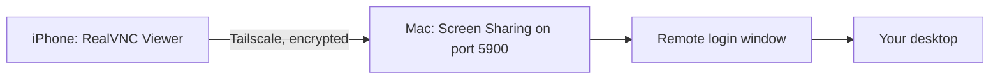

# See and control the Mac from an iPhone

This guide is not part of Sleepless, which only keeps the Mac awake. With Sleepless on, the Mac stays awake with the lid closed, and macOS keeps drawing the screen. This guide adds the screen itself: macOS Screen Sharing, reached over Tailscale, viewed in a VNC app on the iPhone. Everything here is free and built in.



## 1. Keep the Mac awake

1. Install Sleepless, as the README says.
2. Check that the menu bar shows the cup, which means Keep Awake is on.

## 2. Turn on Screen Sharing on the Mac

Do this with the lid open, because macOS asks for your password on the Mac's screen.

1. Open System Settings > General > Sharing, or run:

   ```bash
   open "x-apple.systempreferences:com.apple.Sharing-Settings.extension"
   ```

2. Turn on Screen Sharing and open its ⓘ button.
3. Set Allow access for to Only these users, with your user.
4. Turn on VNC viewers may control screen with password, click Password and set one of up to 8 characters.
5. Click Done.

Step 4 is required for RealVNC. Without it, macOS only offers Apple's own login methods, and RealVNC fails with an error saying the server is not running or uses something incompatible.

## 3. Connect the iPhone through Tailscale

1. Install Tailscale on the Mac and on the iPhone, and sign in to the same account on both.
2. Find the Mac's Tailscale address, such as `100.x.y.z`, in the Tailscale app or with:

   ```bash
   tailscale ip -4
   ```

3. Do not open port 5900 on the router. Only devices in your Tailscale account can reach the Mac, and Tailscale encrypts the traffic, which covers the weak VNC password.

## 4. Set up RealVNC Viewer on the iPhone

1. Install RealVNC Viewer from the App Store. It is free.
2. Add a computer with the Mac's Tailscale address.
3. Connect, with Tailscale on in the iPhone, and type the VNC password from section 2.

## 5. Log in on the remote login window

The iPhone first shows a macOS login window, even when the Mac is open and unlocked. The VNC password does not say who you are, so macOS opens a separate login window for the remote connection.

1. Type your macOS user and password.
2. If macOS asks, choose to share the current screen, so you land on your own desktop with your apps.
3. With Lock the Mac on in Sleepless Settings, the Mac locks when the lid closes, so type your password once more on the lock screen.

## 6. Control the Mac

- Close the lid, keep Sleepless on, and connect from anywhere with Tailscale on in the iPhone.
- Tap to click, drag to move the pointer, and open the keyboard from the RealVNC toolbar.
- Pinch to zoom: the MacBook screen is large on a phone.
- Disconnect from the RealVNC toolbar when done; the Mac keeps running.

## Troubleshooting

| Symptom                            | Cause and fix                                                                             |
|------------------------------------|-------------------------------------------------------------------------------------------|
| Server not running or incompatible | Turn on VNC viewers may control screen with password, as in section 2                     |
| Cannot connect at all              | Turn on Tailscale on the iPhone; check that the Mac is awake and the menu bar shows a cup |
| Login window every time            | Expected with the VNC password; type your macOS user and password                         |
| Black screen at first              | Sleepless turned the display off; tap or move the pointer to wake it                      |
| Mac fell asleep                    | Sleepless turns off below the battery level in Settings or at critical heat; plug it in   |

To check the Mac side from a terminal:

```bash
netstat -an -p tcp | grep '\.5900 '                             # Screen Sharing listening
ioreg -rd1 -c IOPMrootDomain | grep '"SleepDisabled"'          # Yes while Sleepless is on
```
